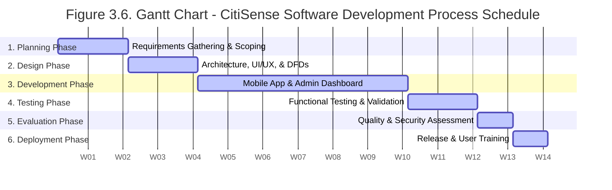
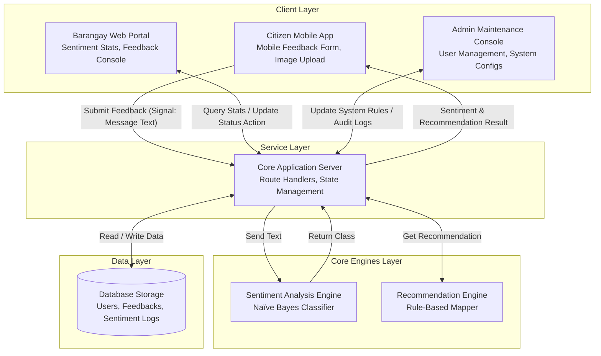
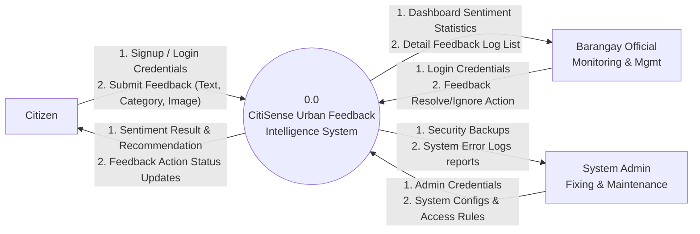
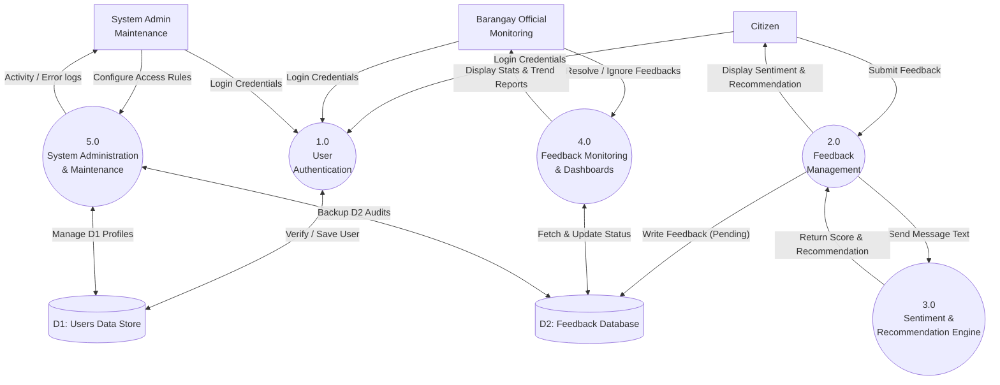

# CitiSense Editable Mermaid Diagrams

Copy the code blocks below and paste them into [Mermaid Live Editor](https://mermaid.live/) or any Mermaid-compatible tool (like Notion or Figma plugins) to instantly generate perfectly spaced, fully editable diagrams!

---

### Figure 3.6: Gantt Chart



---

### Figure 3.2: System Architecture Diagram



---

### Figure 3.3: Use Case Diagram (with 3 Actors!)

```mermaid
usecaseDiagram
    actor "Users (Citizens)" as U
    actor "Barangay Officials\n(Monitoring & Management)" as B
    actor "System Admin\n(Fixing & Maintenance)" as A

    package "CitiSense System Boundary" {
        usecase "UC1: Create Account / Log In" as UC1
        usecase "UC2: Submit Community Feedback\n(Category, Message, Image)" as UC2
        usecase "UC3: View Sentiment Analysis &\nSystem Recommendation Results" as UC3
        usecase "UC4: Monitor Statistics Dashboard\n(Real-Time Community Metrics)" as UC4
        usecase "UC5: Manage Pending Feedbacks\n(Resolve or Ignore Logs)" as UC5
        usecase "UC6: Manage User Access Control &\nSystem Configurations" as UC6
        usecase "UC7: Review System Error Logs &\nPerform Database Backups" as UC7
    }

    U --> UC1
    U --> UC2
    U --> UC3

    B --> UC1
    B --> UC4
    B --> UC5

    A --> UC1
    A --> UC6
    A --> UC7
```

---

### Figure 3.4: DFD Level 0 (Context Diagram)



---

### Figure 3.5: DFD Level 1


