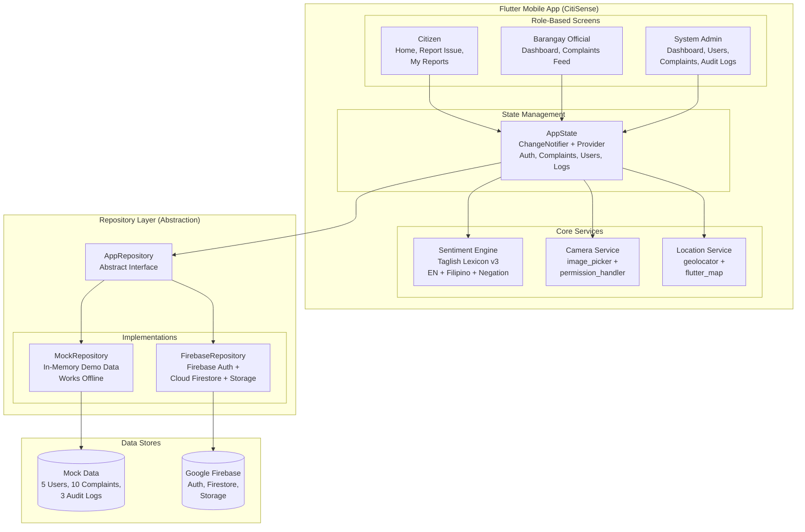
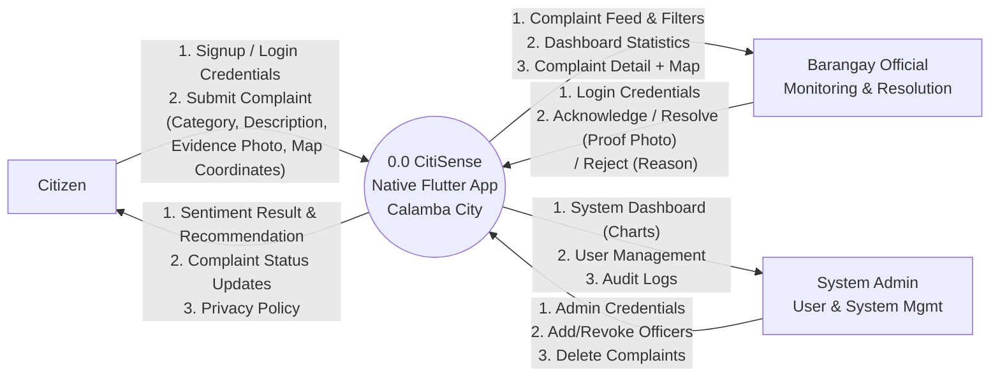
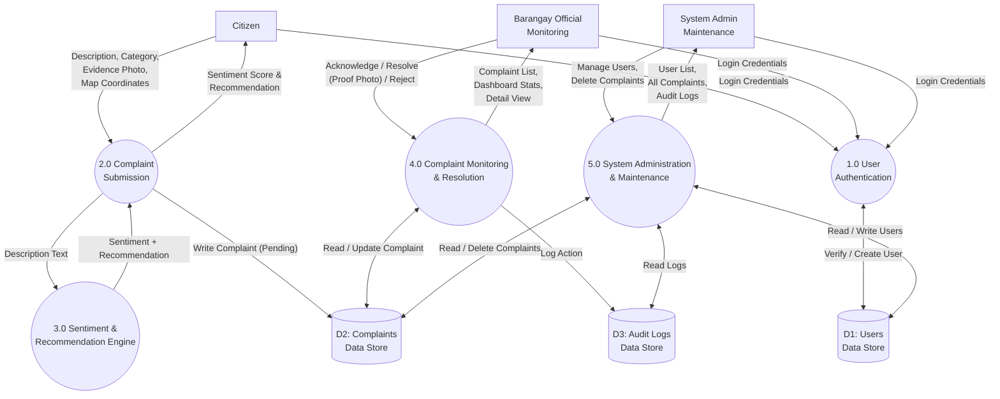
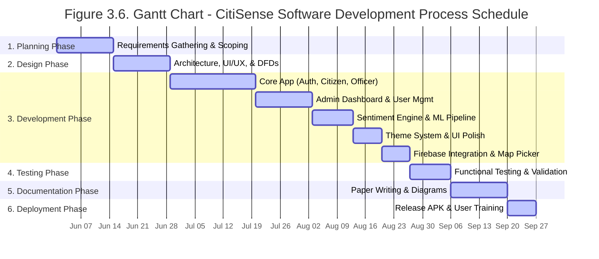

# CitiSense Editable Mermaid Diagrams

Copy the code blocks below and paste them into [Mermaid Live Editor](https://mermaid.live/) or any Mermaid-compatible tool (like Notion or Figma plugins) to instantly generate perfectly spaced, fully editable diagrams!

---

### Figure 3.2: System Architecture Diagram



---

### Figure 3.3: Use Case Diagram

```mermaid
usecaseDiagram
    actor "Citizen" as C
    actor "Barangay Official" as O
    actor "System Admin" as A

    package "CitiSense Native Flutter App" {
        usecase "UC1: Create Account / Log In" as UC1
        usecase "UC2: Submit Complaint\n(Category, Description, Evidence Photo,\nMap Pin Location)" as UC2
        usecase "UC3: View Sentiment Analysis\n& Auto-Recommendation" as UC3
        usecase "UC4: Track Complaint Status\n(With Status Timeline)" as UC4
        usecase "UC5: View Dashboard Statistics\n(Charts & Metrics)" as UC5
        usecase "UC6: Acknowledge Complaint" as UC6
        usecase "UC7: Resolve Complaint\n(Upload Proof Photo)" as UC7
        usecase "UC8: Reject Complaint\n(Provide Reason)" as UC8
        usecase "UC9: Manage Users\n(Add Officer, Revoke/Restore)" as UC9
        usecase "UC10: View All Complaints\n(Delete if needed)" as UC10
        usecase "UC11: View Audit Logs" as UC11
        usecase "UC12: Change Theme\n(Light/Dark/System, High Contrast)" as UC12
        usecase "UC13: View Privacy Policy" as UC13
    }

    C --> UC1
    C --> UC2
    C --> UC3
    C --> UC4
    C --> UC12
    C --> UC13

    O --> UC1
    O --> UC5
    O --> UC6
    O --> UC7
    O --> UC8
    O --> UC12
    O --> UC13

    A --> UC1
    A --> UC5
    A --> UC9
    A --> UC10
    A --> UC11
    A --> UC12
    A --> UC13
```

---

### Figure 3.4: DFD Level 0 (Context Diagram)



---

### Figure 3.5: DFD Level 1



---

### Figure 3.6: Gantt Chart


